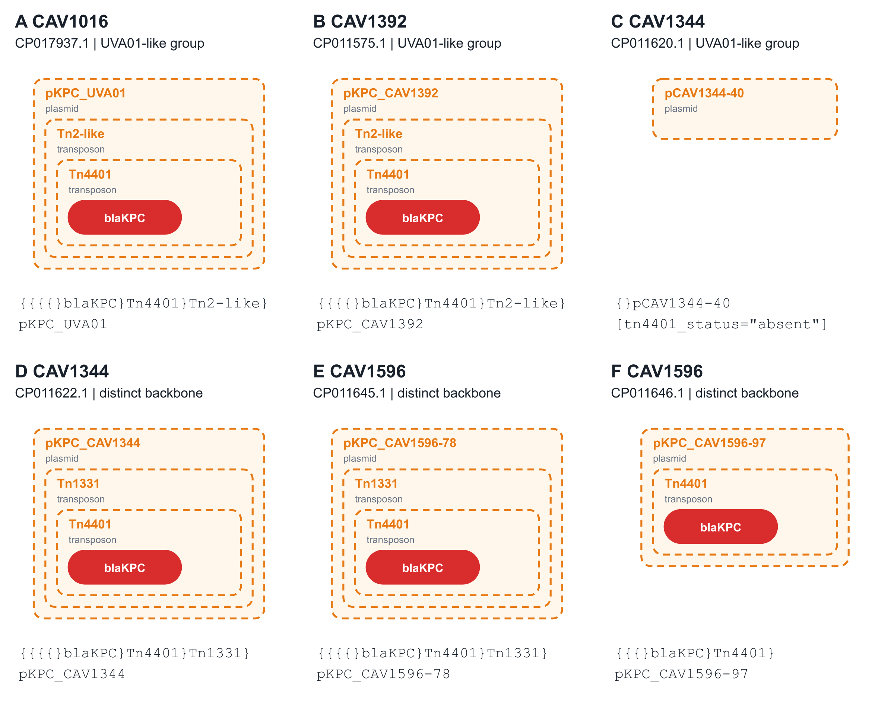

# CellGen

CellGen is a compact text format for describing cellular genome organisation. It records chromosomes, other biological entities such as plasmids and genes, and what is contained within them.

**[Open the visualiser](https://cell-format.vercel.app/)** to build a record, paste your own notation or import an annotated GenBank or GFF3 file.

## Reading the format

| Notation | Meaning |
| --- | --- |
| `(...)label` | A chromosome and the entities inside it |
| `{...}label` | Another biological entity and what it contains |
| `,` | Separates entities at the same level |
| `;` | Separates cells |
| `[key="value"]` | Adds attributes, such as a type or accession |

Parentheses mean chromosome, and only chromosome. Curly braces can represent any other biological entity; use a `type` attribute to state its class. Labels follow the closing bracket. Empty brackets mean that no contained entities are recorded.

## A chromosome and a plasmid

```text
()chr1, {}pBAD[type="plasmid"]
```

The chromosome and plasmid are separate entities in one cell.


## Nested containment

```text
{
  { {}blaKPC-3[type="gene"] }Tn4401[type="transposon"]
}pKpQIL[type="plasmid"]
```

The gene `blaKPC-3` is inside the transposon `Tn4401`, which is inside the plasmid `pKpQIL`. Nesting the brackets records those relationships directly.


## Two cells

```text
()chr1, {}pA[type="plasmid"] ; ()chr2, {}pB[type="plasmid"]
```

A semicolon separates the cells. Each cell here contains a chromosome and a plasmid.


These images are static exports from the visualiser's circular and containment views.

## Examples from the manuscript

The manuscript compares six published plasmid components from four *Klebsiella pneumoniae* isolates in [Sheppard et al. (2016)](https://doi.org/10.1128/AAC.00464-16). The examples distinguish the authors’ plasmid groups from the presence and enclosing context of the selected gene-containing element.



The [full records and provenance](examples/sheppard2016/README.md) retain source accession versions, entity types and publication-derived relationships. The [query results](examples/sheppard2016/query-results.tsv) retrieve the enclosing entities and published group attributes. Paste the [four-cell collection](examples/sheppard2016/collection.cellgen) into the [visualiser](https://cell-format.vercel.app/) to explore it.

## Grammar

In this EBNF, quoted punctuation is literal, square brackets mark optional content, and braces mark repetition.

```ebnf
Document        = Cell , { ";" , Cell } ;
Cell            = CellularElement , { "," , CellularElement } ;
CellularElement = Chromosome | Entity ;
Chromosome      = "(" , [ EntitySet ] , ")" , Annotation ;
Entity          = "{" , [ EntitySet ] , "}" , Annotation ;
EntitySet       = Entity , { "," , Entity } ;
Annotation      = [ Label ] , [ Attributes ] ;
Attributes      = "[" , KeyValue , { "," , KeyValue } , "]" ;
KeyValue        = Key , "=" , Quoted ;
Label           = BareLabel | Quoted ;
```

A bare label uses letters, digits, underscores, dots, colons or hyphens. Labels containing spaces or reserved punctuation must be double-quoted, for example `{}"resistance gene"[type="gene"]`. Attribute values are double-quoted strings; attribute keys start with a letter or underscore and use the same characters as bare labels.

Each cell contains at least one top-level chromosome or entity. Chromosomes cannot be nested, but other entities can be nested to any depth. Commas separate siblings and attributes; semicolons separate cells. Whitespace and line breaks between tokens are optional, so the examples above can also be written on one line.

See the [format specification](docs/specification.md) for escaping and validation rules.

## Documentation

- [Web visualiser](docs/visualiser.md): build and edit records, import annotations, export diagrams and run the app locally.
- [Python](docs/python.md): installation, parser API and command-line tools.
- [TypeScript](docs/typescript.md): parser and renderer APIs, and integration with other applications.
- [Format specification](docs/specification.md): grammar, labels, attributes and syntax rules.
- [More examples](docs/examples.md) and [published biological structures](examples/real_world.md).
- [GenBank and GFF3 import](docs/import.md): annotation handling and import options.
- [Validation](docs/validation.md): diagnostics and conformance checks.

## Authors

Centre for Genomic Pathogen Surveillance, University of Oxford

- Julio Diaz Caballero
- Nabil-Fareed Alikhan
- Khalil AbuDahab
- Sophia David
- David Aanensen
